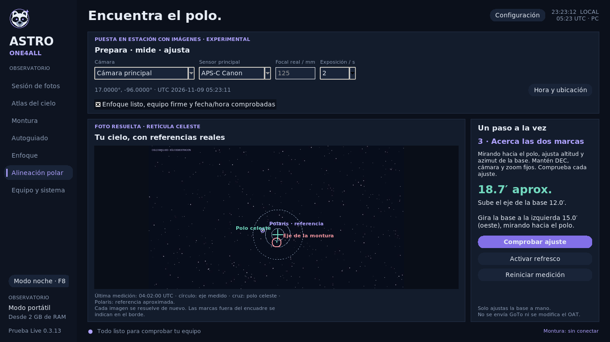

# Astro One4All 🦝

Un observatorio portátil en español para dar una segunda vida a computadoras antiguas.
Control de OpenAstroTracker, captura fotográfica, atlas y herramientas de puesta en estación,
con una interfaz ligera y modo nocturno rojo.

**Versión 0.3.13 · experimental · buscamos colaboradores y personas que prueben el sistema.**

Este repositorio publica el código fuente y la receta de construcción. **Todavía no
ofrece una ISO pública 0.3.13 lista para grabar.** Los archivos de prueba y las tarjetas
personales de desarrollo no se distribuyen como instaladores.



La imagen ilustra la interfaz con un cielo simulado; no es una validación de precisión polar.

## Qué hace

- Control OAT mediante un único controlador INDI: conexión, seguimiento, mando manual,
  GoTo, parada y consulta de hora/ubicación. El enlace se conserva al navegar.
- Canon: guarda RAW + JPG en la SD de la cámara y recibe solo el JPG. Caché limitada.
- Atlas local con 13,372 objetos, carta de estrellas, visibilidad, encuadre y propuestas
  editables de focal y captura para APS-C y Full Frame.
- Plate solving offline y comprobación del encuadre entre exposiciones, cuando el
  motor y los índices necesarios están instalados.
- Asistente polar experimental: tres orientaciones resueltas, retícula y comprobación
  del ajuste manual de altitud/azimut de la base.
- PHD2 opcional mediante INDI. El flujo básico necesita únicamente montura y cámara
  principal; el enfoque puede ser manual.
- Modo rojo, protección contra apagado de pantalla y suspensión en la Live dedicada.

## Qué está comprobado

Se han completado **148 pruebas automáticas en Linux**, pruebas de geometría sintética,
lectura WCS con Astrometry.net real y arranques BIOS/UEFI emulados con 2 GB de RAM.

Los registros del prototipo físico confirman conexión OAT v1.13.22 y capturas R50
con CR3 + JPG en su SD. Una secuencia llegó a 55 fotos antes de un error de cámara
ocupada; su causa sigue abierta. Esto no acredita estabilidad de una noche completa.

Consulta la [tabla de estado y límites](docs/ESTADO_PUBLICO_0313.md).

## Para quién es esta primera publicación

Para colaboradores y personas que quieran probar y reportar resultados. El equipo
de referencia es una Acer ES1-111, 2 GB de RAM, USB 2.0 y una microSD de sistema de 32 GB,
con Canon EOS R50 y OAT Mega 2560 + RAMPS 1.4. Otros equipos requieren validación propia.

La receta apunta a **Debian 13 amd64, CPU x86 de 64 bits y BIOS o UEFI amd64**.
No cubre ARM, procesadores de 32 bits ni cualquier PC de forma universal.

La alineación polar, Bulb, el guiado con estrellas y otros modelos de cámaras no se
presentan como compatibilidad confirmada. El programa no sustituye todas las funciones
de NINA. No incluye AutoPA ni enfoque motorizado.

## Explorar el código y colaborar

Para la interfaz y las pruebas en Debian 13:

```sh
sudo apt update
sudo apt install python3-tk python3-numpy python3-astropy python3-pil python3-pil.imagetk python3-serial xvfb xauth
python3 -m astroall panel
xvfb-run -a python3 -m unittest discover -s tests -p 'test_*.py' -v
```

Estos pasos permiten explorar la interfaz y ejecutar pruebas. Para controlar equipos
reales hacen falta también los controladores y servicios de la Live. En la R50 se
utiliza libgphoto2 2.5.33; el paquete de Debian puede ser anterior.

- [Construir una Live desde una carpeta limpia](docs/USB.md).
- [Puesta en estación con imágenes](docs/PRUEBA_0313.md).
- [Cámaras y adaptadores](docs/CAMARAS_MODULOS.md).
- [Cómo contribuir](CONTRIBUTING.md).

Los documentos que mencionan versiones 0.2 o 0.3.x anteriores son historial de
desarrollo; esta página y la tabla de estado describen la publicación actual.

## Licencias y créditos

El código original de Astro One4All se publica bajo [MIT](LICENSE).
El catálogo adaptado de OpenNGC/HYG conserva **CC BY-SA 4.0**, sus atribuciones,
revisiones y avisos en [astroall/data](astroall/data/README-DATA.txt).
Los componentes externos conservan sus licencias; MIT no los relicencia.
Consulta las [fuentes y referencias](docs/FUENTES.md).

Astro One4All es un proyecto independiente. Las marcas mencionadas identifican
los programas, proyectos y dispositivos con los que se integra.
