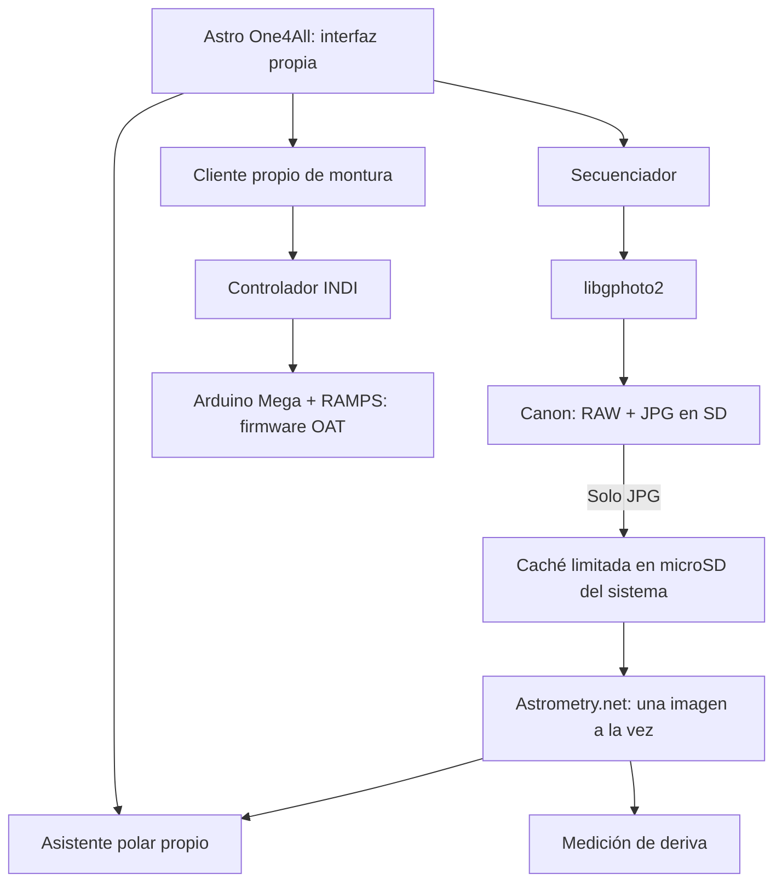

# Diseño de Astro One4All

## Producto propio, controladores reutilizables

La aplicación propia es la interfaz principal, coordina las tareas y es independiente de KStars/Ekos. Linux es la base del sistema; libgphoto2 habla con la Canon; INDI traduce acciones de montura al firmware OAT; astrometry.net identifica el campo; Astropy transforma coordenadas al horizonte. Reutilizar estos componentes evita volver a escribir controladores de cámaras y motores, sin hacer depender el producto de la interfaz de otro programa.

## Presupuesto de recursos

Objetivo: funcionar con 2 GB; aún necesita mediciones reales. Sin navegador ni Electron, sin copia de sistema a RAM, sin RAW en el cliente, sin apilado/procesado final durante adquisición y sin varios solvers simultáneos. La caché gestiona hasta 64 MiB de JPG terminados, más un archivo parcial transitorio. Cada JPG descargado puede ocupar hasta 16 MiB, y su descompresión ocupa más memoria que el archivo comprimido.

El solver limita CPU a 45 s y espera total a 90 s. En Linux con `prlimit` limita su espacio de direcciones a 1 GiB; índices demasiado grandes pueden entonces fallar. Esto no garantiza que todo el sistema permanezca por debajo de 2 GB: hay que medir desktop, controladores, cachés y zram juntos. Zram usa RAM comprimida, no crea RAM nueva.

## Ópticas

El cálculo usa focal real y ancho de sensor de 22.3 mm como valor inicial editable. Las cuatro ópticas confirmadas por el usuario están en el selector, incluido TTArtisan 10 mm f/2. Un zoom requiere indicar su focal actual.

Para validar plate solving empieza con 50 mm o el 55–250 a 55 mm. Un ultrangular tiene distorsión y un campo amplio que pueden requerir otros índices y parámetros. El campo calculado es una estimación geométrica, no una calibración de la lente.

## Límites de la versión

La versión 0.3 incorpora atlas SQLite local, planificación offline, encuadre/mosaico, exposición/ISO, Bulb experimental, HFR manual, recenter con verificación y PHD2/dither. La integración utiliza un solo controlador propio OAT como dueño del puerto serie. Sus respuestas se leen por comando (sin respuesta, un carácter o hasta #); no expone EEPROM, Sync ni cambio de Home. Los pulsos de guiado son finitos y el movimiento manual vence si deja de renovarse.

La cámara vive en un proceso separado no daemon. Bulb utiliza un plazo propio y una cláusula de cierre: intenta ReleaseFull incluso al cancelar. Un fallo USB puede impedir confirmar el cierre; se informa explícitamente y no se repite la exposición. La Canon no aporta guiado continuo mientras expone. El estado de sesión es atómico; las tomas inciertas no se repiten ni se reanudan al reiniciar.

El actualizador instala en un directorio de versión y cambia el lanzador, conservando la 0.2 y las preferencias. PHD2 tiene bibliotecas privadas en el paquete offline para evitar instalar dependencias desde internet en la Acer. No configura ni conecta hardware durante la actualización.

Pendientes: validación física, recuperación automática revisable, enfoque motorizado, rotador y meridian flip específico de la mecánica del OAT. No equivale aún a todo NINA. Las correcciones por JPG tienen límite angular y exigen resolución posterior satisfactoria; el mosaico estima campos, sin medir la orientación de cámara ni garantizar solape con un ultrangular distorsionado.
